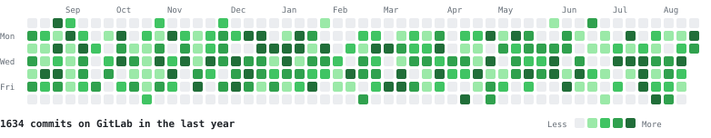

# gitlab-heatmap

Your commits are on GitLab. Your GitHub contribution graph is empty. This
action draws the real one and pushes it to your profile repository every
morning.



It counts commits, one square per day, in the same shades GitHub uses for light
and dark mode.

## Use it

Put this in `.github/workflows/gitlab-heatmap.yml`, inside the repository named
after your username:

```yaml
name: GitLab heatmap

on:
  schedule:
    - cron: "17 4 * * *"
  workflow_dispatch:
    inputs:
      backfill:
        description: "Walk the whole history instead of the recent window"
        type: boolean
        default: false

permissions:
  contents: write

jobs:
  draw:
    runs-on: ubuntu-latest
    steps:
      - uses: actions/checkout@v5
      - uses: moghaddas/gitlab-heatmap@v1
        with:
          gitlab-token: ${{ secrets.GITLAB_READ_TOKEN }}
          backfill: ${{ inputs.backfill }}
```

Then point your `README.md` at the SVG:

```markdown

```

`GITLAB_READ_TOKEN` is a GitLab personal access token carrying `read_api` and
nothing else. Anyone who can add a workflow to the repository reads that
secret, and `read_api` only gets them your commit history.

## Why not the events API

Every other tool in this space reaches for it. `GET /events?action=pushed`
gives one row per push, ready to plot.

It measures the wrong thing. Twelve commits in a single push is one event, so a
day of real work shows as a pale square. `push_data.commit_count` counts what
moved rather than what you wrote, so merging a colleague's branch lands on your
graph. GitLab also prunes old events, which caps how far back you can go.

This reads `/projects/:id/repository/commits` instead. One row per commit,
filtered to your author address, kept for as long as the repository exists.

## Design decisions

**Default branch only.** `all=true` returns one copy of a commit per branch
that reaches it. On my own history that turned 12,484 into 26,282, with 10,670
on a single day. Ids are tracked across projects too, so a fork or a mirror
cannot double-count.

**Several addresses.** Git commits carry whichever address was configured at
the time, and most people own three or four. Leave `identities` empty and it
reads them from the token owner, including the GitLab noreply one. Set it to
add an old account the token does not know about.

**A cache it can correct.** The history lives in
`data/gitlab-contributions.json`, committed next to the SVG. A normal morning
asks GitLab for the last three weeks only, not everything since 2015. Those
days replace whatever was cached for them, so a rebase drops out of the graph
instead of living there forever.

**A run that fails loudly.** An expired token answers 401 on every project. A
tool that skips failures would delete the refetched window, put nothing back,
and report success while three weeks vanished. This stops instead. So does a
walk where most projects failed to read, or one handed nothing at all. It
retries rate limits and server errors before any of that.

## The first run

The daily schedule refreshes recent days only. Fill in the history once, using
the `backfill` input the workflow above declares:

```
gh workflow run gitlab-heatmap.yml -f backfill=true
```

Expect a few minutes, then seconds on every later run.

## Options

| Input | Default | |
|---|---|---|
| `gitlab-token` | required | Token with `read_api` |
| `gitlab-url` | `https://gitlab.com` | Base URL of a self-hosted instance |
| `identities` | from the token owner | Comma-separated author addresses |
| `out` | `gitlab-heatmap.svg` | Where to write the SVG |
| `cache` | `data/gitlab-contributions.json` | Where to keep the history |
| `backfill` | `false` | Walk everything instead of the window |
| `since` | `2015-01-01` | Backfill start date |
| `window` | `21` | Days to refresh on a normal run |
| `weeks` | `53` | Columns to draw, up to 53 |
| `steps` | `0,2,5,10` | Upper bound of each shade, four at most |
| `label` | `{total} commits on GitLab in the last year` | Caption |
| `commit` | `true` | Commit and push when the graph changes |
| `commit-message` | `Update the GitLab heatmap` | |
| `commit-user-name` | `github-actions[bot]` | |
| `commit-user-email` | the bot noreply address | |

Set `commit-user-email` to your own GitHub noreply address and these commits
count on your contribution graph too. Some people want that, others find it
dishonest. It is off by default.

## Run it locally

The script is one file and imports only the standard library.

```
export GITLAB_TOKEN=glpat-...
python3 gitlab_heatmap.py --backfill
python3 gitlab_heatmap.py
python3 test_heatmap.py
```

The drawing options above work on the command line with two dashes, `--out`
through `--label`. Two differ: `gitlab-url` is `--url`, and `identities` is
`--identity`, repeated per address. The token comes from `GITLAB_TOKEN`, and
committing is the action's job.

## Limits

- **The token decides what the graph shows.** Every project it can read is
  counted, so a work account draws your work history. That is usually the
  point, but check what you expose: the SVG carries daily commit counts, and a
  reader can spot your holidays.
- **Membership only.** It walks the projects you belong to. A commit you
  authored in a repository you have since left is invisible.
- **Committer date, in UTC.** A rebase moves a commit to the day it was
  replayed, which is how GitHub behaves too. Days are bucketed by that
  timestamp in UTC, not its local offset, so late evening work in California
  lands on the following square.
- **One address per commit.** It does not parse `Co-authored-by` trailers.

## License

MIT. See [LICENSE](LICENSE).
